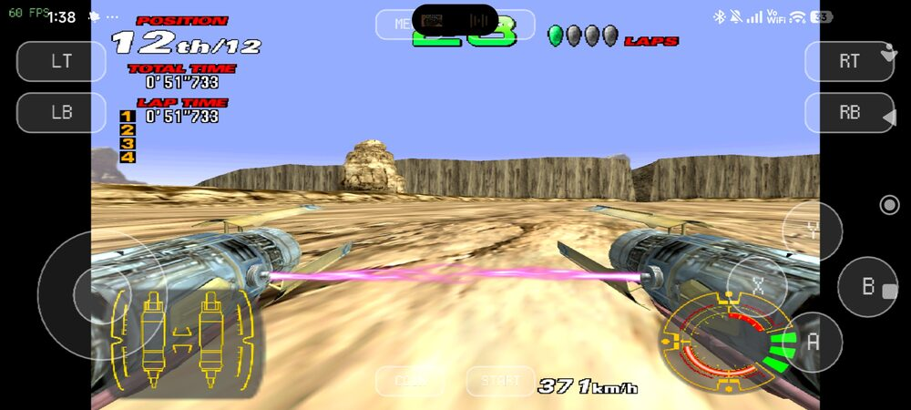
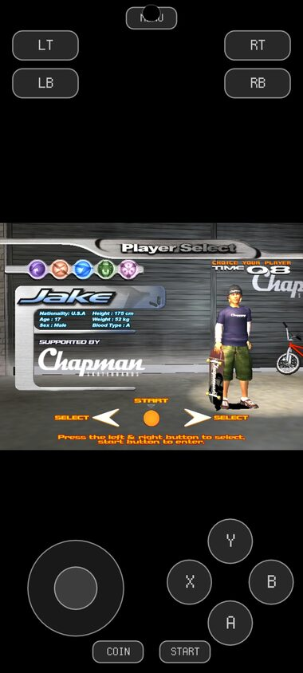
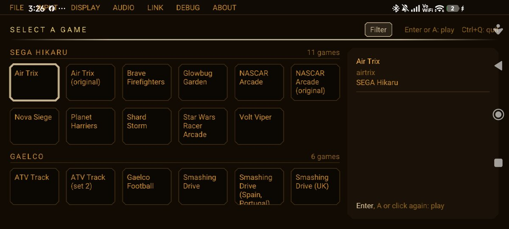
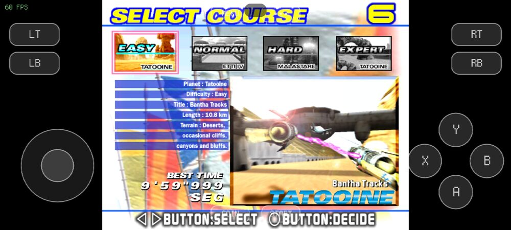
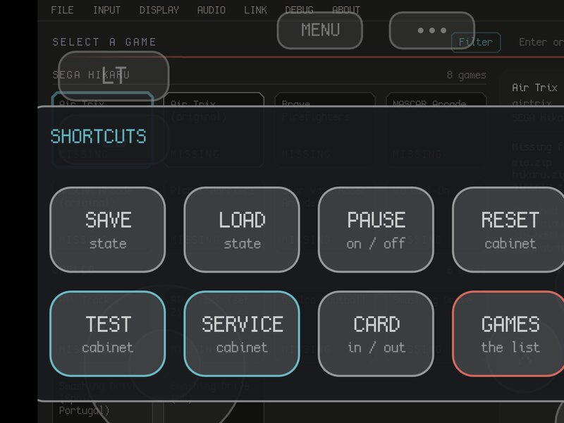
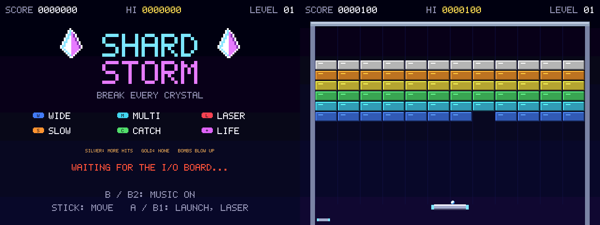
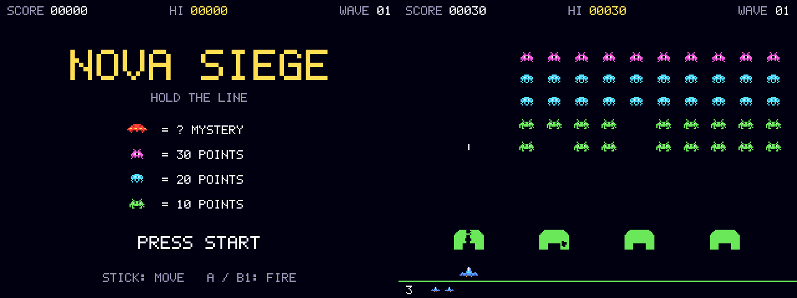
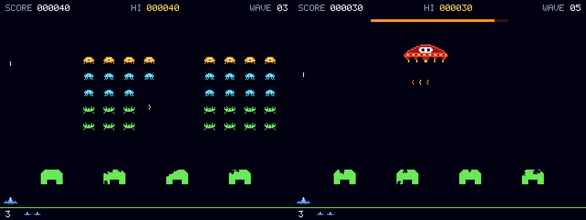

# Odin pour Android

Portage Android d'[Odin](https://github.com/Tovarichtch/Odin), l'émulateur SEGA
Hikaru et Gaelco ATV Track de Réda Chérif-Touil (GPL 3). Ce dépôt ne contient
pas le code d'Odin : le workflow `.github/workflows/build.yml` récupère
Odin au commit de `odin.version`, applique `patches/0001-android.patch` et
construit l'APK, publié dans la release **`odin-apk`** de ce dépôt :
https://github.com/Laurent-67370/odin-android/releases/download/odin-apk/odin.apk

<p align="center">
  
</p>

<p align="center">
  
  &nbsp;
  
</p>

<p align="center"><em>Star Wars Racer Arcade en course (60 images/s) ; Air Trix en portrait ; la liste des jeux.
Captures d'un Snapdragon 8 Gen 2.</em></p>

## État

| Point | État |
|---|---|
| Air Trix, NASCAR Arcade, Star Wars Racer Arcade | jouables, **60 images/s** (Snapdragon 8 Gen 2), aussi en résolution 2× |
| Brave Firefighters | jouable, visée au doigt : le jet part sous le doigt |
| Gaelco Football | second stick tactile pour le tir, à essayer |
| Virtual-On Force | deux leviers sur les deux sticks tactiles, à essayer |
| Manette tactile | stick flottant, boutons, gâchettes, vibration, panneau de raccourcis ; en paysage, rangée dans deux colonnes latérales ; stick plus sensible dans les jeux à directions, chaque tape comptée même très brève |
| Format de l'image | 4:3 (borne), 16:9 ou plein écran |
| Menus | agrandis ×3 en paysage, police Roboto nette |
| Portrait / paysage | les deux, bascule en jeu |
| Quitter puis revenir dans l'app | le jeu reprend (pas d'écran noir) |
| Records et réglages des bornes | gardés, aussi quand Android ferme l'app en arrière-plan |
| Mises à jour | par-dessus l'ancienne version (APK signé d'une clé fixe) |
| **NOVA SIEGE** (homebrew du dépôt) | jeu de tir original pour la Hikaru : son, musique, record gardé, vagues variées, vaisseau-mère ; [odinhb.zip](https://github.com/Laurent-67370/odin-android/releases/download/odin-apk/odinhb.zip) dans `Odin/roms` |
| **SHARD STORM** (homebrew du dépôt) | casse-briques original : 12 niveaux, capsules, musique, record gardé ; [odinshrd.zip](https://github.com/Laurent-67370/odin-android/releases/download/odin-apk/odinshrd.zip) dans `Odin/roms` |

Connu, venant d'Odin lui-même : Air Trix peut planter à l'écran des meilleurs
scores ([Tovarichtch/Odin#52](https://github.com/Tovarichtch/Odin/issues/52)).

Le portage est présenté à l'auteur d'Odin dans
[Tovarichtch/Odin#54](https://github.com/Tovarichtch/Odin/issues/54), avec un
suivi des améliorations (manette tactile, adaptations par jeu, mémoire gardée
en arrière-plan, homebrew).

**Et iOS ?** Pas pour l'instant (question posée dans
[Tovarichtch/Odin#56](https://github.com/Tovarichtch/Odin/issues/56)). Odin n'a
pas d'interpréteur : il recompile toujours le SH-4 et l'ARM7 en ARM64, donc il
lui faut un JIT, ce qu'iOS n'accorde qu'à une app installée en sideload avec un
outil d'activation du JIT. Sa mémoire de code (`MAP_JIT`,
`pthread_jit_write_protect_np`) devrait passer à la méthode des émulateurs iOS.
Le reste (SDL3, MoltenVK, la manette tactile) se porterait ; il faudrait un Mac
pour construire et un iPhone pour tester.

## Installer

1. Télécharger `odin.apk` depuis la release `odin-apk`, l'ouvrir sur le
   téléphone et autoriser l'installation depuis cette source.
2. Au premier lancement, autoriser Odin à accéder à tous les fichiers. Il crée
   le dossier `Odin/` du téléphone :
   - `Odin/roms` : les jeux (archives MAME `.zip` / `.7z`), avec `hikaru.zip` et
     `mie.zip` pour les jeux Hikaru ;
   - `Odin/artwork` : les images d'`Odin-Artwork.zip` (facultatif) ;
   - `odin.ini` et `odin.log` y sont écrits.
   Sans l'autorisation, Odin utilise `Android/data/org.odinport.android/files`.

Il faut un téléphone ARM64. Odin dessine par défaut avec **Vulkan** (conseillé) ;
OpenGL ES 3.2 reste au choix, page Display (option « API »). L'émulation
Hikaru est lourde : un téléphone haut de gamme récent est conseillé.

## Performances

<p align="center">
  
</p>

Sur un Snapdragon 8 Gen 2 (Adreno 740), en Vulkan, Air Trix tourne à **60 images
par seconde** en course : la carte graphique travaille environ 9 ms sur les
16,7 ms d'une image.

- **Résolution** : MENU → Display → 3D QUALITY → *Internal resolution*. La
  3D est calculée en 640×480 (1×, la borne) ; en **2×** (1280×960, à peu près la
  hauteur d'un écran de téléphone), l'image est bien plus fine et Air Trix tient
  toujours 60 images/s sur ce téléphone. 3× et plus dépassent la finesse de
  l'écran pour un coût bien plus grand. Dans la même rubrique, *Anisotropic
  filtering* 4× (textures vues de biais) et *Upscaling mode* Snap 2D (scores et
  chronos nets) coûtent peu.
- Les shaders sont compilés au premier lancement d'un jeu (quelques secondes),
  puis relus depuis le cache au lancement suivant (0,1 s), sans à-coups en jeu.
- Le compteur d'images s'affiche en haut à gauche ; `odin.log` (dossier `Odin/`)
  détaille le temps de chaque partie de l'émulation et du rendu.

## Commandes

- **Manette tactile** par-dessus le jeu : stick, A B X Y, LB RB, LT RT
  (gâchettes, pédales), COIN, START et MENU (menu d'Odin). Elle se masque
  quand une vraie manette (Bluetooth / USB) est branchée. Les commandes de
  chaque jeu se règlent dans MENU → Controls.
  - Les touchers arrivent au jeu dès qu'ils se produisent (Android ne les
    regroupe plus jusqu'à l'image suivante de l'écran).
  - Le **stick flotte** : son centre se place là où le pouce se pose, près du
    cercle dessiné.
  - Dans un jeu qui n'attend que des directions (haut, bas, gauche, droite :
    Nova Siege, Gaelco Football, Virtual-On), le stick est **trois fois plus
    sensible** : un petit glissement du pouce suffit, sans pousser à
    mi-course. Les jeux à commande analogique (volant, manche) gardent toute
    la course.
  - Une tape, même très brève, tient son bouton au moins 60 ms : le jeu la
    voit toujours.
  - Une **courte vibration** confirme chaque appui (à couper avec la variable
    d'environnement `ODIN_NO_BUZZ`).
- **Air Trix** sur la manette tactile :

  | Bouton | Commande de la borne |
  |---|---|
  | Stick | YAW : tourner la planche |
  | LB / RB | UP / DOWN |
  | X / B | LEFT / RIGHT (les deux boutons de la borne) |
  | LT / RT | ROLL : incliner la planche à gauche / à droite |
- **Star Wars Racer Arcade** (deux leviers, un par moteur, comme la borne) : le
  stick tactile pousse les deux moteurs ensemble vers l'avant, et gauche /
  droite donne plus de puissance à un moteur qu'à l'autre pour tourner.
- **Brave Firefighters** (la lance à incendie se vise) : pas de stick ; un
  doigt posé **sur l'image** vise à cet endroit et projette l'eau tant qu'il
  reste posé, en glissant pour suivre le feu. LT donne le brouillard (FOG), RT
  l'eau sans bouger la visée. Un seul doigt vise à la fois, les autres peuvent
  tenir les boutons en même temps.
- **Gaelco Football** : le stick de gauche déplace le joueur, A / B / X sont les
  boutons A / B / C de la borne, et un **second stick** à droite donne le tir
  (de côté et vers l'avant) : il flotte sur toute la moitié droite de l'écran,
  là où il n'y a pas de bouton, et se dessine à côté des boutons A B X Y.
- **Virtual-On Force** (deux leviers, comme la borne) : le levier gauche au
  stick de gauche, le levier droit au **second stick** à droite ; gâchettes
  LT / RT, turbos LB / RB, P.I.B. sur Y. La carte de sauvegarde s'insère avec
  CARD dans le panneau •••.
- Ces adaptations se font d'elles-mêmes selon les commandes du jeu : visée
  pour un jeu à viseur, second stick pour un jeu qui en a un.
- **Raccourcis** : le bouton **•••** (à droite de MENU) ouvre un panneau de gros
  boutons pour les touches qu'un téléphone n'a pas : SAVE / LOAD (l'état, F2 /
  F4), PAUSE (P), RESET (Ctrl+R), **TEST** et **SERVICE** (0 / 9, les boutons de
  service de la borne, tenus tant que le doigt reste : le panneau reste ouvert
  pour parcourir les menus de test), CARD (F6), **GAMES** (retour à la liste des
  jeux) et **QUIT** (quitter Odin). GAMES et QUIT demandent un second toucher
  (« SURE? ») pour éviter une sortie par erreur. Toucher ailleurs referme le
  panneau.

  
- **Portrait ou paysage**, comme on tient le téléphone (le verrouillage de la
  rotation est respecté) : la manette se place autour de l'image dans les deux.
  En paysage, tout est dans deux colonnes sur les côtés (à gauche LT, LB, MENU,
  le stick et COIN en bas ; à droite RT, RB, •••, A B X Y et START en bas) :
  rien ne couvre le milieu de l'image (chronos, scores). Quand l'image est
  élargie (16:9, Full) et passe sous les boutons, ceux-ci deviennent plus
  transparents.
- **Plein écran** : les barres d'Android restent masquées (un balayage depuis le
  bord les fait revenir un instant), aussi au retour dans l'application.
- **Format de l'image** (MENU → Display → 3D QUALITY → *Picture shape*) :
  **4:3** comme la borne (bandes sur les côtés), **16:9** un tiers plus large
  (un peu étiré) ou **Full**, toute la largeur de l'écran (étiré). Enregistré
  dans `odin.ini` (`[display] shape`).
- **Menus lisibles** : en paysage, la bibliothèque et le menu d'Odin sont
  agrandis ×3 selon la densité de l'écran (en portrait, trop étroit, ils gardent
  leur taille). Leurs lettres sont celles de **Roboto**, la police d'Android,
  dessinées nettes à cette taille (au lieu des pixels agrandis de Cozette).
- La touche **Retour** d'Android ouvre / ferme le menu (Échap).
- Dans les menus, on touche les éléments comme avec une souris.

## Ce que fait le patch

- CMake : `libmain.so` (au lieu d'un exécutable), SDL3 en `libSDL3.so`,
  OpenGL ES (`GLESv3`, `EGL`) et Vulkan, pages de 16 Ko.
- Dossiers : `ODIN_ANDROID_FOLDER` (dossier `Odin/`) et `ODIN_ANDROID_DATA`
  (données de l'APK) donnés par l'activité ; polices de `/system/fonts`.
- Pas de X11 ni d'evdev ; sélecteurs de dossiers remplacés par `Odin/roms`.
- Fenêtre en plein écran pour SDL (mode immersif) ; menu agrandi au facteur
  entier de la densité de l'écran quand il garde 760×340 points.
- La mémoire sauvegardée de la borne (records, réglages) est écrite quand
  l'app passe en arrière-plan : Android peut la tuer sans la fermer.
- Vulkan : nouvelle surface quand l'app revient au premier plan (Android lui
  donne une nouvelle fenêtre) ; chaîne d'images refaite seulement quand la
  fenêtre change de taille.
- `touch_pad.cpp` : la manette tactile, une manette virtuelle SDL dessinée avec
  Dear ImGui (testable sur PC avec `ODIN_TOUCH_PAD=1`) ; dans un jeu à viseur,
  le doigt sur l'image devient la souris (`touch_pad_aim`), sans stick ; dans
  un jeu à second stick, un second stick flottant à droite.
- Vulkan par défaut, comme sur macOS ; le recompilateur ARM64 d'Odin (fait
  pour les Mac Apple Silicon) tourne tel quel. L'émulation reste sur les cœurs
  rapides du processeur.
- Rendu adapté aux cartes graphiques de téléphone (Vulkan) :
  - les lumières lues directement dans leur tampon par le shader des pixels,
    sans copie par pixel (la passe opaque passe de ~30 ms à ~3 ms par image) ;
  - pas de test alpha (`discard`) dans la passe opaque, pour que la carte
    teste la profondeur avant d'ombrer ;
  - SPIR-V optimisé (`-Os`), profondeur calculée aux sommets, table des
    dessins et dessins indirects groupés, tampons copiés en mémoire de la
    carte ;
  - chaîne d'images en mode *mailbox*, à l'orientation de l'écran ;
  - cache des pipelines écrit dès qu'ils sont prêts (une app Android est
    tuée, jamais fermée).

## Homebrew

Le dossier [`homebrew/`](homebrew/) contient deux jeux faits maison pour la
borne SEGA Hikaru : ils démarrent par le BIOS SEGA comme de vrais jeux,
affichent par la couche 2D, lisent les commandes par le JVS et jouent leur son
sur l'AICA. **SHARD STORM** est un casse-briques original : douze niveaux de
cristal, briques d'argent, d'or et bombes, six capsules (raquette large,
multi-balles, laser, ralenti, colle, vie), musique et record gardé ;
[odinshrd.zip](https://github.com/Laurent-67370/odin-android/releases/download/odin-apk/odinshrd.zip)
dans `Odin/roms`.

<p align="center">
  
</p>

Le premier jeu, **NOVA SIEGE**, est un jeu de
tir à écran fixe original : une formation d'aliens qui marche et accélère, des
boucliers destructibles, un pillard bonus, des vagues qui changent de forme,
des blindés, des plongeurs, un vaisseau-mère toutes les 5 vagues, du son, de
la musique et un record gardé.

Pour y jouer sur le téléphone : télécharger
[odinhb.zip](https://github.com/Laurent-67370/odin-android/releases/download/odin-apk/odinhb.zip)
(publié avec l'APK, construit à chaque version) et le mettre dans
`Odin/roms`, à côté de `hikaru.zip` et `mie.zip`. Le jeu s'appelle **Nova
Siege** dans la liste. Les commandes répondent une dizaine de secondes après
le lancement (l'écran l'indique).

<p align="center">
  
  <br>
  
</p>

## Construire soi-même

```sh
sudo apt install glslang-tools      # glslangValidator
./fetch-odin.sh                      # Odin + sous-modules + patch dans odin-src/
echo "sdk.dir=$ANDROID_HOME" > local.properties
./gradlew assembleRelease            # app/build/outputs/apk/release/app-release.apk
```

Pour mettre à jour Odin : changer `odin.version`, relancer `./fetch-odin.sh` et
corriger le patch s'il ne s'applique plus.

## Signature (mises à jour sans désinstaller)

Android n'installe un APK par-dessus l'ancien que s'il est signé avec la même
clé. Le workflow la lit dans deux secrets du dépôt (Settings → Secrets and
variables → Actions) :

- `ODIN_KEYSTORE_B64` : le fichier de clé PKCS12 (alias `odin`), en base64 ;
- `ODIN_KEYSTORE_PASSWORD` : son mot de passe.

Sans eux, chaque APK est signé avec une clé de test nouvelle à chaque
compilation, et il faut désinstaller avant d'installer.
