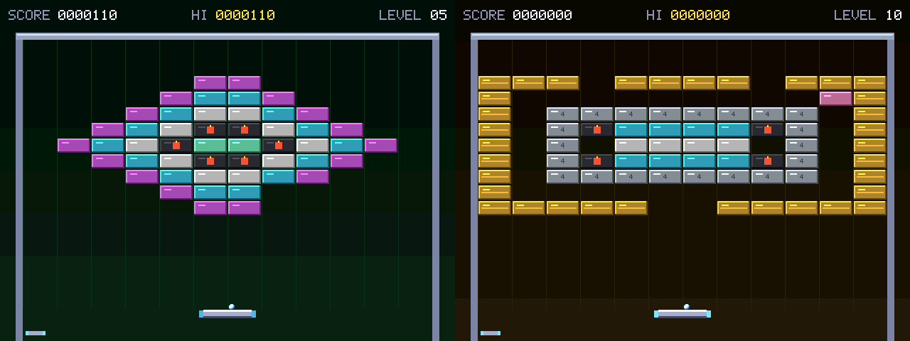
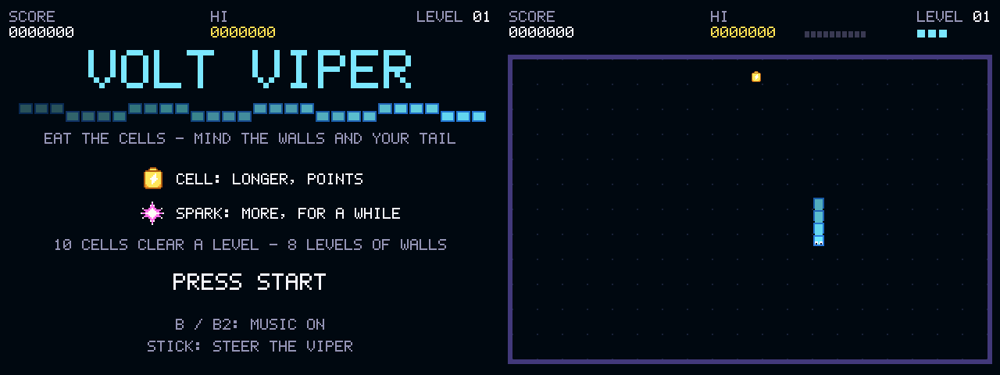
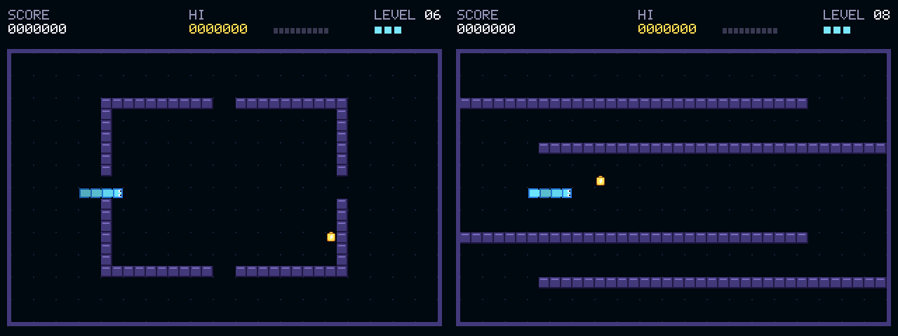

# Homebrew pour la SEGA Hikaru (sous Odin)

Des jeux faits maison qui tournent sur la borne **SEGA Hikaru** telle qu'Odin
l'émule : de vrais programmes pour son processeur SH-4, lancés par le BIOS
SEGA comme les jeux d'origine. Trois jeux originaux, qui partagent une même
bibliothèque (`src/`) :

| Jeu | Genre | Fichier |
|---|---|---|
| [**NOVA SIEGE**](#nova-siege) | tir à écran fixe | `odinhb.zip` |
| [**SHARD STORM**](#shard-storm) | casse-briques | `odinshrd.zip` |
| [**VOLT VIPER**](#volt-viper) | serpent | `odinvipr.zip` |

## NOVA SIEGE

Un jeu de tir à écran fixe, original. Une
formation d'aliens avance de côté et descend à chaque bord, de plus en plus
vite à mesure qu'elle se vide ; le chasseur en bas tire (deux tirs à la fois ;
un appui fait pendant que les deux volent part dès qu'un tir se libère) depuis
l'abri de quatre boucliers que les tirs et les bombes rongent. Un pillard
traverse le haut de l'écran de temps en temps : 50 à 300 points. Trois
chasseurs.

Les vagues changent :

- **la forme de la formation**, quatre à tour de rôle : le mur, le coin, les
  pinces, le damier (son nom s'affiche au début de la vague) ;
- **des blindés** (orange, 40 points) qui encaissent deux tirs : la rangée du
  haut dès la vague 3, deux rangées dès la 7, trois dès la 11 ;
- **des plongeurs** dès la vague 2 : un alien quitte la formation et fond sur
  le chasseur en zigzaguant, puis revient à sa place par le haut ; abattu en
  vol, il rapporte le double ;
- **un vaisseau-mère toutes les 5 vagues**, annoncé par une alarme : une
  barre de vie, des tirs en éventail (trois, puis cinq quand il est à moitié
  détruit), plus rapide à mesure qu'il est touché ; 1000 points par cycle.

**Le son** : tirs, explosions, les quatre notes du pas de la formation (qui
accélèrent avec elle), la sirène du pillard, le tintement des coups sur les
blindés et le vaisseau-mère, la plongée, les jingles de départ, de vague
nettoyée et de fin de partie. Tout est synthétisé par `nova-siege/sounds.py`.

**La musique** : trois morceaux composés pour le jeu, qui bouclent : un
calme en la mineur pour l'écran titre, un entraînant en mi mineur pour les
vagues, un rapide en ré mineur pour le vaisseau-mère. Basse, mélodie,
arpèges ou nappe, et batterie. **B (bouton 2) sur l'écran titre la coupe ou
la remet** ; le choix est gardé.

**Le record** est gardé dans la RAM sauvegardée de la borne : il reste d'une
partie et d'un lancement à l'autre.

| Commande | Action |
|---|---|
| Stick (ou flèches) gauche / droite | déplacer le chasseur |
| A / bouton 1 (ou B / bouton 2) | tirer |
| START | commencer une partie |
| B / bouton 2 (écran titre) | musique on / off |

| Ennemi | Points |
|---|---|
| Blindé (orange, deux tirs) | 40 |
| Guetteur (rose, rangée du haut) | 30 |
| Méduse (bleue, 2 rangées) | 20 |
| Scarabée (vert, 2 rangées du bas) | 10 |
| Pillard (rouge, de passage) | 50, 100, 150 ou 300 |
| Plongeur abattu en vol | le double de son espèce |
| Vaisseau-mère | 10 par coup, 1000 × cycle à la fin |

Pendant la dizaine de secondes où la carte d'entrées-sorties s'initialise,
l'écran titre affiche « WAITING FOR THE I/O BOARD... ».


## SHARD STORM

Un casse-briques, original : une raquette en bas garde la balle en jeu, et la
balle brise les briques de cristal du niveau. **Douze niveaux** dessinés
(les bandes, la pyramide, le damier, le cadre, le losange, les colonnes, le
champ de mines, le cœur, le zigzag, la forteresse, la spirale, la tempête),
puis ils recommencent, plus vite. La balle accélère à mesure que les briques
tombent ; son angle dépend de l'endroit où elle touche la raquette.

| Brique | Effet |
|---|---|
| Couleur | un coup ; 50 à 120 points selon la couleur |
| Argent (chiffre) | plusieurs coups, d'autant plus que le niveau avance |
| Or | indestructible |
| Bombe | explose et brise les briques autour (en chaîne) |
| Scintillante | lâche toujours une capsule |

Les briques de couleur lâchent parfois une **capsule** ; la raquette
l'attrape (500 points) :

| Capsule | Effet |
|---|---|
| **W** (bleue) | raquette large |
| **M** (cyan) | chaque balle devient trois |
| **L** (rouge) | laser : A tire deux rayons |
| **S** (orange) | balle ralentie |
| **C** (verte) | raquette collante : la balle s'y pose, A la relance |
| **+** (violette) | une raquette de plus |

Trois raquettes, une de plus à 20 000 points puis tous les 30 000 ; 1000
points par niveau nettoyé. **Son** : rebonds, une note de cristal par
brique (plus aiguë en haut), tintement de l'argent et de l'or, explosions,
laser, jingles. **Musique** : trois morceaux composés pour le jeu (un aérien en
do majeur pour l'écran titre, un groove en sol mineur et un morceau vif en fa
majeur pour les niveaux, en alternance). Record gardé, musique coupée ou
remise par B sur l'écran titre, comme pour NOVA SIEGE.

| Commande | Action |
|---|---|
| Doigt sur l'image (téléphone) ou souris | la raquette se place sous le doigt |
| Toucher l'image | lancer la balle ; tirer au laser (comme A) |
| Stick (ou flèches) gauche / droite | déplacer la raquette (elle accélère si on tient) |
| A / bouton 1 | lancer la balle ; tirer au laser |
| START | commencer une partie |
| B / bouton 2 (écran titre) | musique on / off |

Sur le téléphone, la raquette suit le doigt : le jeu se déclare dans la liste
d'Odin avec un viseur (`"aim": true` dans son `game.json`, deux axes analogiques
comme la lance de Brave Firefighters), et la manette tactile passe en mode
visée. Le programme JVS de la MIE lit les axes à chaque relevé et garde
l'octet haut du canal n à l'adresse Z80 `E203 + 2n` : 0 au bord gauche de
l'image, FF au bord droit.




## VOLT VIPER

Une vipère de lumière avance sur une grille. Chaque **cellule d'énergie**
qu'elle mange l'allonge de trois anneaux ; elle ne doit toucher ni un mur ni sa
propre queue. Une **étincelle** apparaît de temps en temps, qui rapporte plus
tant qu'elle brille. **Dix cellules** finissent un niveau ; **huit niveaux** de
murs (le champ libre, les barres, les blocs, les portes, la croix, la boîte aux
quatre portes, les piliers, les lacets), puis ils recommencent, plus vite. La
vipère accélère tous les deux niveaux.

Trois vipères, une de plus à 5000 points puis tous les 7500. **Son** : la
bouchée (plus aiguë à chaque cellule du niveau), l'étincelle, le choc, les
jingles. **Musique** : deux morceaux composés pour le jeu (mi mineur pour
l'écran titre, la mineur pour le jeu). Record gardé ; B sur l'écran titre
coupe ou remet la musique.

| Commande | Action |
|---|---|
| Stick (ou flèches) | tourner ; deux virages d'avance sont retenus |
| START | commencer une partie |
| B / bouton 2 (écran titre) | musique on / off |





## Jouer sur le téléphone

L'APK connaît les trois jeux, et leurs fichiers sont publiés avec lui à chaque
version :

1. Télécharger
   [odinhb.zip](https://github.com/Laurent-67370/odin-android/releases/download/odin-apk/odinhb.zip)
   (NOVA SIEGE),
   [odinshrd.zip](https://github.com/Laurent-67370/odin-android/releases/download/odin-apk/odinshrd.zip)
   (SHARD STORM) et
   [odinvipr.zip](https://github.com/Laurent-67370/odin-android/releases/download/odin-apk/odinvipr.zip)
   (VOLT VIPER).
2. Les ajouter : MENU → File → Add games… (ou les mettre à la main dans
   `Odin/roms`, à côté de `hikaru.zip` et `mie.zip`).
3. Lancer **Nova Siege**, **Shard Storm** ou **Volt Viper** dans la liste des jeux.

Après une mise à jour de l'APK qui change un homebrew, retélécharger son
fichier : Odin vérifie que les EPROM sont celles que sa liste attend.

## Construire

```sh
sudo apt install gcc-sh4-linux-gnu python3-pil   # le compilateur C pour SH-4, Pillow pour les PNG
python3 build.py                        # tous les jeux → build/<nom>.zip et build/<nom>.json
python3 build.py --game shard-storm     # un seul
python3 build.py --games chemin/vers/odin-games.json   # ajoute aussi les jeux à la liste d'Odin
```

Chaque jeu est un dossier avec un `game.json` (son nom de jeu à la MAME et son
titre) : `nova-siege/` donne `build/odinhb.zip`, `shard-storm/` donne
`build/odinshrd.zip`, `volt-viper/` donne `build/odinvipr.zip`. Un zip contient les deux EPROM du jeu (`<nom>.ic29` et
`<nom>.ic30`) et se met dans le dossier des ROM d'Odin, à côté de
`hikaru.zip` et `mie.zip`.

Pour un nouveau jeu : un dossier avec `game.json`, `main.c`, `assets/` (ses
sprites en PNG), `sounds.py` et `music.py` (qui s'appuient sur
`tools/synth.py`).

La ROM ne contient **aucun code de SEGA**. Il faut le BIOS de la borne
(`hikaru.zip`, version 0.96) et `mie.zip`, comme pour les autres jeux Hikaru.

## Comment ça marche

### Le démarrage (le BIOS SEGA)

Le BIOS cherche la carte ROM et la lance s'il y trouve :

| Où (dans les EPROM) | Quoi |
|---|---|
| `0x000` | `SAMURAI\0` |
| `0x13C` | 20 entrées de 10 octets décrivant les puces : la taille d'une paire (log2 en Mo), puis des sommes ; `FFFF` = absente |
| `0x390` | la table de chargement : des triplets (adresse sur le bus, adresse en mémoire, longueur), terminée par un triplet dont le premier mot n'est pas positif ; son deuxième mot est le point d'entrée |

Le BIOS copie le programme (ici à `0x8C100000`) et y saute. La carte de
Brave Firefighters, sans puce de chiffrement, sert de modèle (`eprom_mb: 2`).

### L'image : la couche 2D

La Hikaru a deux couches 2D par-dessus (ou sous) la 3D. La couche 1 montre
une zone de la mémoire d'image (`1B000000`, 2048×2048 pixels de 16 bits) :
chaque pixel s'y écrit directement, en ABGR1555, deux pixels par mot de 32
bits, échangés. Les registres de la puce d'affichage (`1A000190` et
suivants) disent où est la couche, son format, si elle est visible et
au-dessus de la 3D.

### Double tampon, texte et sprites

Deux images de la couche 1 sont dans la mémoire d'image (lignes 1024 et
1536) : l'une est affichée pendant que le programme dessine l'autre, puis
`screen_flip()` les échange au début de l'image suivante. Rien ne scintille.

- **Texte** : une police 5×7 dessinée pour ce projet (`tools/font5x7.txt`,
  modifiable à la main), agrandissable (`draw_text`, `draw_number`).
- **Sprites** : les images PNG du dossier `assets/` d'un jeu deviennent des sprites
  (`spr_<nom>`) à la construction ; les pixels transparents ne sont pas
  dessinés (`draw_sprite`, `draw_sprite_scaled`).

### Le son : l'AICA

La carte son est sur le bus externe, page `0C` : le contrôleur mémoire ouvre
la fenêtre `02000000` sur elle (octet `1A` de ses registres, à `04000000`).
Ses registres sont à `02700000`, sa mémoire d'échantillons à `02800000`. Le
jeu tient l'ARM7 de la carte en reset (registre `2C00`) et joue lui-même
les voix : ce sont celles de l'AICA de la Dreamcast (`src/sound.c`).
`KYONEX` déclenche ou coupe toutes les voix selon leur `KYONB` : une voix
qui a fini garde son `KYONB` effacé un peu avant sa fin, pour ne pas
repartir au prochain déclenchement.

### La musique : un séquenceur

Le `music.py` d'un jeu écrit chaque morceau en lignes de notes (`NOTE:TEMPS`, un
temps étant une double croche ; `-` un silence ; `K`, `H`, `S` la grosse
caisse, le charleston, la caisse claire). Les instruments sont des cycles
d'onde bouclés par l'AICA (carré, dent de scie, triangle), avec l'enveloppe
de l'AICA ; `src/music.c` lit les notes à chaque image, sur les voix 16 et
suivantes.

### Le record : la RAM sauvegardée

64 Ko à `00C00000`, sur pile sur la borne, qu'Odin garde dans le fichier
`nvram` du jeu. Le record y est à `F000` (une signature, le score, un
contrôle). Odin l'écrit à la fermeture et, sur Android, quand l'application
passe en arrière-plan.

### Les commandes : le MIE et le JVS

Les commandes passent par le **MIE**, un Z80 qui parle à la carte
d'entrées-sorties en JVS. Au lancement, le jeu y charge le programme JVS du
BIOS de la borne (copié depuis le BIOS, pas inclus dans la ROM), puis
dialogue par une boîte aux lettres en mémoire du Z80 :

- `C004 = 3` : le programme est prêt (après une dizaine de secondes : il
  initialise la carte JVS) ;
- `C001 = 0` : il est libre ; on écrit alors la commande 1 dans `C000` et 1
  dans `C001` ;
- quand `C001` revient à 0 (en 4 ms environ : le jeu l'attend, pour lire
  les commandes de l'instant et non celles de l'image d'avant), les boutons
  sont en `E003` (la borne : TEST =
  bit 7) et `E004`–`E005` (joueur 1, ordre JVS : START, SERVICE, haut, bas,
  gauche, droite, bouton 1, bouton 2, puis boutons 3 à 8).

## Les fichiers

| Fichier | Rôle |
|---|---|
| `src/hikaru.h`, `src/hikaru.c` | la borne : couche 2D et double tampon, image suivante, commandes, RAM sauvegardée |
| `src/gfx.h`, `src/gfx.c` | le dessin : effacer, rectangles, sprites, texte, nombres |
| `src/sound.h`, `src/sound.c` | le son : les voix de l'AICA |
| `src/music.h`, `src/music.c` | le séquenceur de la musique |
| `src/crt0.S`, `src/link.ld` | le démarrage du programme et son placement en mémoire |
| `tools/font5x7.txt` | la police |
| `tools/synth.py` | la synthèse des sons et l'écriture des notes, pour les jeux |
| `<jeu>/game.json` | le nom du jeu dans la liste d'Odin, son titre |
| `<jeu>/main.c` | le jeu |
| `<jeu>/assets/*.png`, `<jeu>/sprites.py` | ses sprites, dessinés en texte par `sprites.py` |
| `<jeu>/sounds.py`, `<jeu>/music.py` | ses sons et sa musique (`E4:2`, `-:4`, `K:2`…) |
| `build.py` | génère la police, les sprites, les sons et la musique, compile, fabrique les EPROM et les entrées de la liste des jeux |

## Limites connues

- Le programme JVS est pris à l'adresse qu'il a dans le BIOS **0.96**. Les
  BIOS 0.92 et 0.84 ne sont pas encore pris en charge.
- Les commandes ne répondent qu'une dizaine de secondes après le lancement
  (l'initialisation de la carte JVS).
- Pas encore de 3D.

## Tester

`build.py --start-wave N` fabrique une ROM qui commence à la vague (NOVA SIEGE)
ou au niveau (SHARD STORM) N ; `--define RECORD_TEST=1234` écrit ce record au
lancement de NOVA SIEGE.
Dans Odin sur PC, `ODIN_WAV=son.wav` enregistre le son de la borne.
